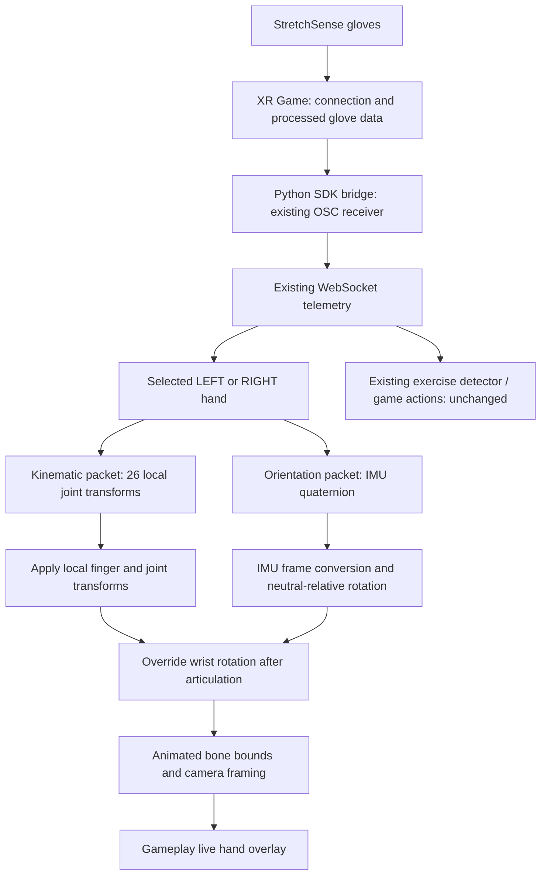

# Gameplay live hand rig: finger bend + 3D IMU rotation

Developer and Codex integration guide for the **updated team project**.
This documents the current implementation, its dependencies and how to restore
it after a pull or integrate it into another gameplay screen.

## 1. What the user sees

In the gameplay Live view, finger bending comes from StretchSense's kinematic
joint transforms while the entire hand turns around its wrist pivot using the
separate IMU quaternion. Pronation/supination therefore rotates the hand while
the fingers can open, close or bend independently at the same time.

This is a real skinned 3D FBX model, not a static image, guidance animation or
exercise-state-driven approximation. The rig does **not** rotate only when a
repetition is detected: its pose follows incoming telemetry independently of
the game-action events.

“Movement in 3D” here means orientation around all three axes, with live finger
articulation. It does **not** mean measured hand translation through space or
independent forearm tracking. IMU data alone does not supply those positions.
The initial valid IMU orientation becomes a display-neutral reference; this is
not an anatomical classification of palm-up/palm-down. Start in a known neutral
pose and use the wrist-tare button when necessary.

## 2. Data flow



The same selected hand must supply both packets. Do not mix left-hand joints
with right-hand orientation, and do not substitute game lane/detection events
for the IMU quaternion.

## 3. Files to keep / copy

Paths below are relative to the repository root; they are not machine-specific
installation paths.

| File | Responsibility |
| --- | --- |
| `glove-dashboard/components/live-hand-rig.tsx` | Loads the SDK FBX, applies joints and optional IMU wrist rotation, manages camera/render lifecycle. |
| `glove-dashboard/lib/wrist-imu.ts` | Validates/converts IMU quaternions, stores neutral reference, handles display tare and derives display roll. |
| `glove-dashboard/components/exercise-session.tsx` | Supplies selected-hand telemetry, Live/Guide mode, tare revision and roll callback to the gameplay overlay. |
| `glove-dashboard/app/page.tsx` | Existing selected-hand/session wiring and vendor tare command; command helper now returns success/failure. |
| `glove-dashboard/hand_models/LeftHandAnims.FBX` and `RightHandAnims.FBX` | Original StretchSense skinned hand assets. |
| `glove-dashboard/hand_textures/RealityL.png` and `RealityR.png` | Existing glove appearance. |
| `glove-dashboard/tests/wrist-imu.test.mjs` | Frame conversion, neutral/tare and actual left/right FBX hierarchy regression checks. |

Keep existing Three.js/FBXLoader dependencies and the React `@/` import alias.
Copy the complete rig component plus its helper rather than copying just the
quaternion assignment into an unrelated mesh. Different models require their
own bone mapping, rest pose, coordinate-frame verification and material setup.

The rig fetches these existing backend routes:

```text
/api/models/left-hand.fbx       /api/models/right-hand.fbx
/api/models/left-glove.png      /api/models/right-glove.png
```

Actual disk directories come from root `neuro.local.json` through `paths.hand_models`
and `paths.hand_textures`. Do not hardcode another developer's drive paths.
See [TEAM_LOCAL_SETUP.md](TEAM_LOCAL_SETUP.md) for machine setup.

## 4. Required telemetry and component inputs

Both packet types are already supplied by the Python bridge. The relevant
shape for one selected hand is:

```ts
type Quaternion = { x: number; y: number; z: number; w: number };
type Vector3 = { x: number; y: number; z: number };
type Joint = { name: string; position: Vector3; orientation: Quaternion };

type RigTelemetry = {
  kinematic?: { joints: Joint[] } | null;
  orientation?: { orientation: Quaternion } | null;
};
```

| `LiveHandRig` prop | Usage |
| --- | --- |
| `side` | `'LEFT'` or `'RIGHT'`; selects the corresponding model. |
| `joints` | Selected hand's live `kinematic.joints`. |
| `orientation` | Selected hand's separate `orientation.orientation` quaternion; not an entire packet or Euler angle. |
| `tareRevision` | Increment after a successfully accepted wrist-tare command; default `0`. |
| `onWristRoll` | Optional callback receiving display degrees or `null`; updates at roughly 10 Hz. |
| `guidanceMode` | Omit for live rendering. Existing exercise/calibration guidance modes bypass live IMU rendering. |

Current gameplay integration:

```tsx
<LiveHandRig
  side={side}
  joints={handHudMode === 'live' ? hand?.kinematic?.joints : undefined}
  orientation={live ? hand?.orientation?.orientation : undefined}
  tareRevision={rigTareRevision}
  onWristRoll={setWristRoll}
  guidanceMode={handHudMode === 'guide' ? mode : undefined}
/>
```

`live` must represent a usable connection for the selected hand, not merely
that an XR Game process exists. For a new integration, also gate `joints` on
your selected-hand live status so a stale packet is not presented as live.
Keep orientation available while switching to Guide: the guidance renderer
ignores it, but its presence preserves the existing neutral reference when
switching back. Do not key/remount the component on every telemetry packet,
IMU angle or tare revision.

Older call sites that pass only `joints` keep their joint-only behaviour.
The new IMU wiring currently applies to the gameplay overlay; it was not
silently enabled in every other page.

## 5. Finger and wrist bone mapping

The source FBX uses `WaveBone_*` names. Crucially:

| SDK joint | FBX bone / range |
| --- | --- |
| `palm` | `WaveBone_0` |
| `hand` (wrist root) | `WaveBone_1` |
| Thumb chain | `WaveBone_2` through `WaveBone_5` |
| Index chain | `WaveBone_6` through `WaveBone_10` |
| Middle chain | `WaveBone_11` through `WaveBone_15` |
| Ring chain | `WaveBone_16` through `WaveBone_20` |
| Pinky chain | `WaveBone_21` through `WaveBone_25` |

`WaveBone_1` parents the palm and finger chains, so rotating this bone turns the
hand around the wrist while preserving the fingers' local articulation.
Do not interpret the misleading numeric order as `WaveBone_0` parenting the wrist.

For each joint, keep the established update:

```ts
bone.position.set(position.x * 100, position.y * 100, position.z * 100);
bone.quaternion.copy(normalizedIncomingJointQuaternion);
```

The scale converts OSC metres to FBX centimetres. Joint transforms are absolute
local transforms, not bend deltas to multiply into the bind pose. Do not add
manual finger spread, scaling, twist, threshold-based poses or guessed thumb axes.
The established model proportions/materials are retained.

After articulation, override only the wrist rotation when a valid IMU pose is
available:

```ts
const wrist = rigBones.get('hand');
const delta = wristPose.update(orientation, animationTimestampMs);
if (wrist && delta) {
  wrist.bone.quaternion.copy(delta).multiply(wrist.rest);
}
```

Do not multiply IMU rotation onto the received wrist quaternion as well. That
could apply the wrist rotation twice. Do not rotate a separate parent group
around the palm/model centre instead of using the SDK wrist pivot.

## 6. IMU coordinate conversion and reference

The IMU packet and joint packets do not share the same receiving conversion.
The implemented helper follows the inspected Unity receiver and source-FBX frame:

```text
Raw OSC IMU (x, y, z, w)
  -> Unity OnOrientation: (-y, -z, x, w)
  -> source FBX frame:    (-y,  z, -x, w)
```

Equivalent negated quaternions represent the same rotation. The helper rejects
missing, non-finite and near-zero quaternions, then normalises valid values.
Apply this mapping **only to the IMU packet**; applying it to the established
finger quaternions would break articulation.

The first valid converted IMU sample is saved as `neutral`. Subsequent samples
produce:

```text
delta = inverse(neutral) * convertedIncomingImu
```

Multiplication order matters. This mirrors the Unity sample's
`inverse(offset) * glove` compensation with a fixed display offset. The renderer
does not add exercise EMA/rolling-window processing, nor does it continuously
rubberband a held rotation back to neutral.

Unity reference behaviour was inspected in `JointVisualiser`, `ImuConfiguration`
(SDK 0.6.6), `HandTrackingConfiguration` (SDK 0.7.0) and the OSC receiver.
`WristDetwister` is deliberately **not** copied: it removes rotational twist and
could conceal the pronation/supination the user wants to see.

## 7. Tare integration

Tare remains a user-triggered vendor SDK command, not an automatic calibration
on every frame. Both gameplay tare buttons use the same wrapper:

```ts
const [rigTareRevision, setRigTareRevision] = useState(0);
const [wristRoll, setWristRoll] = useState<number | null>(null);

async function tareGameplayWrist() {
  const sent = await onTare(); // existing command; return false on failure
  if (sent !== false) setRigTareRevision(value => value + 1);
}
```

The existing parent sends:

```http
POST /api/command
Content-Type: application/json

{"action":"imu_tare","hand":"left"}
```

Use `"right"` for RH. The parent command helper returns `true` for an accepted
HTTP response and `false` on failure. When adapting this to another project,
preserve that explicit result rather than swallowing failures and returning
`undefined` (which the current compatibility wrapper treats as success).
Keep pending/disconnected button guards in place.

When `tareRevision` changes, the display holds identity for 350ms and then
captures the latest available valid orientation as its new reference. This is
a visual settling delay, **not** vendor completion confirmation or a guarantee
that a fresh post-tare packet arrived. Validate it on hardware; upstream packet
timestamps/completion acknowledgement would be needed for stricter coordination.
Keep the physical wrist straight through the tare and settling interval.

Missing orientation/disconnect or a hand-side change resets the reference.
Live/Guide switching does not deliberately reset it. Remounting a fresh session
creates a fresh neutral reference; retain the component if a workflow requires
continuity across sessions.

## 8. Keep the full hand visible

The existing gameplay overlay position and colours stay unchanged. Inside it,
the orthographic camera uses the **animated bone world positions** to determine
the hand's current centre and extent. It pans/expands with the hand rather than
using a cached skinned-mesh bind-pose bounding box.

After updating joints and wrist rotation:

1. Update the model/display world matrices.
2. Expand a bounding box using all mapped bones, including fingertips.
3. Fit camera width/height to the viewport aspect ratio with padding.
4. Move the camera's X/Y centre to the animated hand bounds.

This is framing only. It does not invent hand translation from the IMU and
does not rotate the camera along with the hand (which would hide wrist movement).
Guide/calibration framing follows its existing path.

## 9. ROLL display versus exercise logic

Gameplay ROLL is derived from the neutral-relative quaternion using the FBX
forearm-axis Euler Z angle, converted to degrees. `quaternion.x * 100` is not
an angle and must not be restored.

The readout is a display value, with Euler wrap/gimbal limitations during
combined rotations. It is **not** the pronation/supination detector angle,
range-of-motion report, repetition count or game score. Show `—` when live data
or a valid display angle is unavailable.

No Python exercise thresholds, EMA/window logic, connection handling, XR Game
launch process or LH/RH game-direction mapping is changed by this renderer.

## 10. Validation

From `glove-dashboard`, run:

```powershell
node --test tests/wrist-imu.test.mjs tests/game-controls.test.mjs tests/gameplay-rules.test.mjs tests/festival-assets.test.mjs
.\node_modules\.bin\tsc.cmd --project tsconfig.local.json --noEmit --incremental false
```

Twenty automated checks passed for the documented implementation. Wrist checks
cover coordinate mapping, non-identity neutral poses, held rotations, invalid
inputs, `q/-q`, tare, display degrees, and the actual left/right FBX models:
rotating the wrist changes fingertip world positions without changing finger
bend quaternions or moving the wrist pivot.

Hardware acceptance checklist for **both** LH and RH:

- Start neutral, connect/calibrate normally, then enter gameplay Live view.
- Bend individual fingers: each finger moves correctly without wrist motion.
- Pronate and supinate: the whole hand visibly turns, including palm/back view.
- Keep fingers bent while rotating: finger articulation remains intact.
- Move through combined wrist rotations: no axis reversal, clipping or double rotation.
- Hold a rotated pose: it does not slowly return to neutral while held.
- Tare while neutral: vendor command works and display reference settles correctly.
- Try a failed/disconnected tare: do not report command success or rebase on failure.
- Switch Live → Guide → Live: guidance remains correct and the live reference survives.
- Disconnect/reconnect: stale telemetry is not labelled live; neutral is re-established.
- Confirm existing rep counts, game inputs and reports remain unchanged.

Automated checks cannot confirm sensor accuracy, vendor tare latency or every
physical axis/sign. Hardware testing is still required before claiming parity
with XR Game's complete tracker-based visualisation.

## 11. Troubleshooting / Codex handoff

| Problem | Inspect first |
| --- | --- |
| Fingers move but wrist does not | Gameplay is passing `orientation.orientation`, `live` is true and IMU packets arrive. |
| Hand spins twice / finger shape breaks | IMU is applied once to `WaveBone_1` after joints; finger quaternions remain raw source-FBX values. |
| Wrist rotates but fingers stay neutral | Correct selected-hand `kinematic.joints` are supplied and all 26 names map. |
| Wrong axes or direction | IMU-only conversion and model reference; do not “fix” clinical game direction mapping to correct a rig problem. |
| Rig becomes invisible during rotation | Animated bone bounds, camera aspect/position and valid quaternions. |
| Tare jumps or keeps an old pose | Command success, upstream packet arrival/latency and 350ms visual settling assumptions. |
| Rotation disappears after Live/Guide switch | The component is not unnecessarily remounted and missing orientation is not clearing the reference during Guide. |
| Guide starts moving with real sensor data | `guidanceMode` must bypass the live IMU stage. |
| Model/texture fails to load | Existing `/api/models` routes and machine config, not IMU maths. |

Copyable Codex task:

> Read `doc/GAMEPLAY_LIVE_HAND_RIG.md`, `doc/TEAM_LOCAL_SETUP.md` and the current
> `components/live-hand-rig.tsx` / `lib/wrist-imu.ts`. Integrate the current live
> rig into this checkout's gameplay overlay using the selected hand's existing
> kinematic and orientation packets. Preserve raw joint transforms and the
> SDK FBX mapping, apply converted neutral-relative IMU rotation only once to
> WaveBone_1 after articulation, and retain camera framing and both tare buttons.
> Keep guidance/calibration, Python bridge, XR Game launching, exercise detection,
> game mappings and existing UI placement unchanged. Use configuration for disk
> paths; do not copy another workstation's paths. Run the documented tests and
> clearly distinguish software checks from real-glove acceptance testing.

For change history, see [UPDATED_CODE_RECOVERY.md](UPDATED_CODE_RECOVERY.md).
